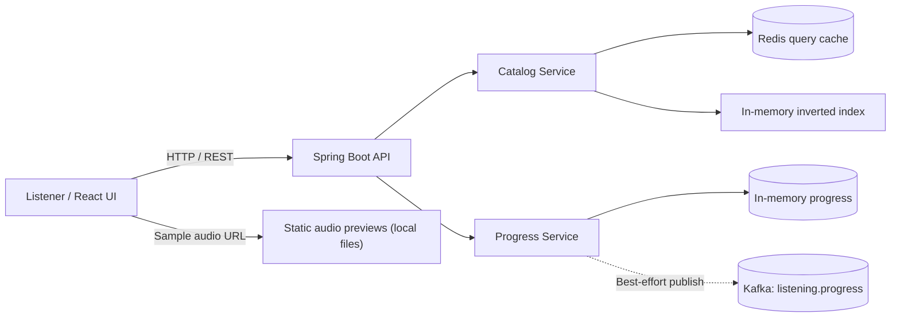

# 🎧 Audiobook Discovery & Listening Platform

**A full-stack audiobook discovery and listening prototype built with Java 21, Spring Boot, React, Redis, and Kafka.**

Explore a searchable catalog, open an audiobook preview, and track listening position through a REST API. This project focuses on the engineering behind a listening experience: **backend API design, indexing, cache-aside data access, asynchronous event publishing, client-side playback, and validation**.

[](https://openjdk.org/)
[](https://spring.io/projects/spring-boot)
[](https://react.dev/)
[](https://redis.io/)
[](https://kafka.apache.org/)

> **Project status — local prototype.** This is an original engineering demonstration with *synthetic* audiobook metadata, not a commercial audiobook service. Audio samples are short synthesized title announcements, **not full audiobook chapters**. Some infrastructure integrations still require independent end-to-end verification.

---

## ✨ What It Does

| Feature | Implementation |
| --- | --- |
| **Discover books** | Search by title, author, and genre with a Java inverted index |
| **Catalog scale for experiments** | Deterministic synthetic catalog; **10,000 records by default**, configurable up to 100,000 or more for local benchmarking |
| **Read catalog metadata** | Spring Boot REST endpoints for search and individual book lookup |
| **Cache searches** | Redis cache-aside reads with a **5-minute TTL** and an in-memory index fallback |
| **Listen in the browser** | React interface with native HTML audio controls for available sample files |
| **Track position** | Per-user/book playback position stored in memory with sequence-number protection against stale updates |
| **Publish listening events** | Kafka producer sends best-effort progress events to `listening.progress` |
| **Validate core logic** | Standalone Java assertions for catalog lookup, search results, and progress-update behavior |

## 🧩 Architecture



**Design decisions**

- **Fast local discovery experiments:** The index maps search tokens to catalog records. Indexed search and linear scans are both implemented so performance can be compared instead of assumed.
- **Graceful cache degradation:** Redis is optional at query time; when it is unavailable, the catalog service reads from its local index.
- **Out-of-order update protection:** A newer listening-progress sequence number takes precedence over an older update for the same user and book.
- **Decoupled event hook:** The backend attempts to publish progress events to Kafka without requiring the listener's HTTP request to wait for a durable downstream workflow. This is **not** an exactly-once messaging design.

## 🛠️ Technology Stack

| Layer | Technologies |
| --- | --- |
| Frontend | React 18, JavaScript, Vite, CSS, HTML audio |
| Backend | Java 21, Spring Boot 3, REST APIs |
| Discovery | Java collections, tokenization, inverted indexing |
| Caching | Redis |
| Messaging | Apache Kafka |
| Infrastructure | Docker Compose, Maven, npm |
| Verification | Java domain assertions, local search benchmark |

## 🚀 Quick Start

### Prerequisites

- **Java 21** and **Maven 3.9+**
- **Node.js 20+** and npm
- **Docker Desktop**, with Docker Engine running

### 1. Start Redis and Kafka

From the repository root:

```bash
docker compose up -d
docker compose ps
```

### 2. Start the Spring Boot backend

Open a terminal in the repository root:

```bash
cd backend
mvn clean test
mvn spring-boot:run
```

The backend listens on **http://localhost:8080** by default.

### 3. Start the React frontend

In a **separate terminal**, from the repository root:

```bash
cd frontend
npm install
npm run dev
```

Open **http://localhost:5173**.

> **Note on audio:** The repository includes the source code but not the 256 generated MP3 preview files from the local demo. To enable those previews, copy your own `book-0.mp3` through `book-255.mp3` into `frontend/public/audio/`. The catalog also contains entries without audio. Without the MP3 files, clicking an available preview can result in a missing-media response.

### 4. Check the application

```bash
curl http://localhost:8080/api/health
curl "http://localhost:8080/api/books?q=mystery&limit=5"
curl http://localhost:8080/api/books/bk-0
```

For playback-progress updates:

```bash
curl -X POST http://localhost:8080/api/progress \
  -H "Content-Type: application/json" \
  -d '{"userId":"demo-user","bookId":"bk-0","second":10,"sequence":1}'
```

Retrieve saved progress (while the same backend process is still running):

```bash
curl http://localhost:8080/api/progress/demo-user/bk-0
```

## 📁 Repository Layout

```text
.
├── backend/
│   ├── pom.xml
│   └── src/main/
│       ├── java/com/audibleportfolio/
│       │   ├── api/
│       │   ├── config/
│       │   ├── domain/
│       │   └── service/
│       └── resources/application.yml
├── frontend/
│   ├── public/audio/
│   ├── src/
│   ├── index.html
│   └── package.json
├── benchmark/
│   ├── DomainTests.java
│   └── Benchmark.java
├── docker-compose.yml
├── .gitignore
└── README.md
```

## 🧪 Testing & Performance

**Domain correctness.** The `benchmark/DomainTests.java` program contains **12 assertions** covering catalog size, lookup behavior, matching search results, input checks, and ordering of progress updates. These are standalone Java checks, **not a claim that Redis or Kafka integration tests passed**.

**Local search benchmark.** The `benchmark/Benchmark.java` program can generate a larger synthetic catalog and compare indexed search with a linear scan. It tests **in-process Java search**, not HTTP requests, cache hit latency, Kafka throughput, or real-world traffic.

The earlier local mixed-query experiment found **slower median indexed search than linear scan** for that workload. The result is useful for evaluating selectivity and early-exit behavior, not evidence of a search-speed improvement.

```bash
# From the repository root, after creating a suitable output folder:
mkdir -p .build
javac -d .build backend/src/main/java/com/audibleportfolio/domain/*.java benchmark/DomainTests.java benchmark/Benchmark.java
java -cp .build DomainTests
java -cp .build Benchmark 100000
```

**Measured claims will be updated as infrastructure-backed tests are completed.** No production latency, concurrent-user capacity, cache speedup, or Kafka delivery guarantee is claimed here.

## 🔍 Current Limitations and Next Steps

This is a working *local application prototype*, not a production audiobook platform. It does **not** yet include:

- Persisted accounts and playback history across backend restarts
- User authentication and authorization
- Complete chapter-based narration or licensed commercial audio
- A durable Kafka outbox, consumer, or guaranteed event delivery
- CDN-backed audio streaming or production observability
- Verified large-scale, concurrent end-to-end load tests

Future engineering work includes durable progress storage, chapter navigation, API integration tests, caching benchmarks, Kafka consumer processing, and longer original neural-narration demos.

## 🔗 Related Project

**[Neural Audiobook Voice Production Pipeline](https://github.com/MSrikar7/neural-audiobook-voice-production)** — a separate Python/Piper/ONNX Runtime project for speech synthesis, waveform validation, and model-reuse benchmarking. Its local sequential comparison achieved **68.42% mean processing-time reduction** across three 20-job runs. That measurement belongs to the voice-production project, **not** this listening application's search or streaming performance.

---

### 👨‍💻 Author

**Venkata Srikar Manikonda** · [GitHub](https://github.com/MSrikar7) · [LinkedIn](https://www.linkedin.com/in/srikar-manikonda/)

*Built to explore practical software engineering problems behind audiobook discovery, playback, and AI-assisted voice production.*
